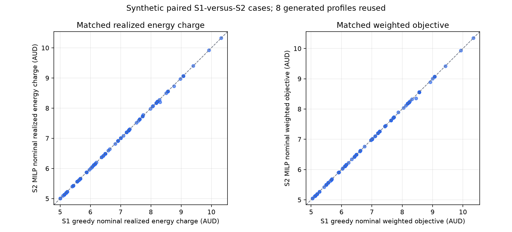
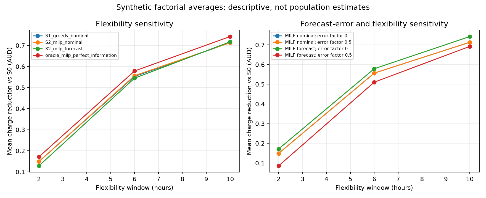
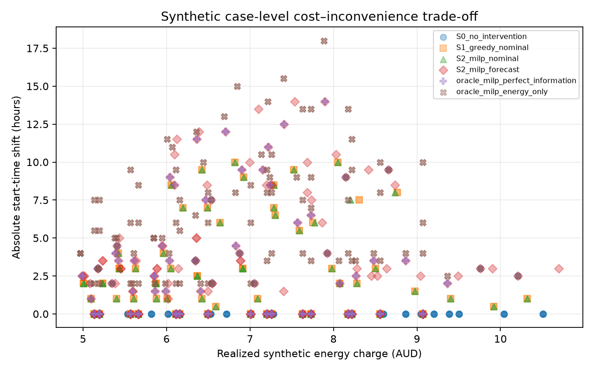

# Demo visuals and screenshot guide

The visuals below are intentionally labeled by evidence type. Do not retouch
data, remove synthetic/preview annotations, or imply that a chart came from a
customer account.

## Captured product flow

The following clean local browser captures were saved on 31 October 2026 from
the seeded synthetic accounts. They document the observed browser interactions;
they are not a screen recording or evidence of production deployment.

| Screen | Capture | What it documents |
|---|---|---|
| Login | [`captures/login.png`](./captures/login.png) | Clean login page; no credentials entered or visible. |
| Analytics dashboard | [`captures/analytics-dashboard.png`](./captures/analytics-dashboard.png) | Synthetic profile and one-day usage summary. |
| Configured bill estimate | [`captures/analytics-bill-estimate.png`](./captures/analytics-bill-estimate.png) | $3.89 configured-tariff estimate, partial-data label, and missing-interval caveat. |
| Recommendations | [`captures/analytics-recommendations.png`](./captures/analytics-recommendations.png) | Observed patterns and conditional, unquantified opportunities. |
| Upload screen | [`captures/upload-fixture-screen.png`](./captures/upload-fixture-screen.png) | NEM12 fixture upload entry point. |
| Selected fixture | [`captures/nem12-fixture-selected.png`](./captures/nem12-fixture-selected.png) | Fabricated repository fixture selected for upload. |
| Import result | [`captures/nem12-unresolved-direction.png`](./captures/nem12-unresolved-direction.png) | 336 imported readings and the unresolved E1 direction warning. |
| Scheduling account dashboard | [`captures/scheduling-account-dashboard.png`](./captures/scheduling-account-dashboard.png) | No-readings disclosure and the direct synthetic scheduling action. |
| Tariff configuration form | [`captures/tariff-configuration.png`](./captures/tariff-configuration.png) | Tariff selection screen and illustrative-rate disclaimer. |
| Synthetic TOU tariff | [`captures/tou-tariff-windows.png`](./captures/tou-tariff-windows.png) | All four synthetic periods and synthetic-baseline disclosure. |
| Scheduling inputs | [`captures/scheduling-inputs.png`](./captures/scheduling-inputs.png) | Appliance task inputs and TOU windows. |
| Recommendation times | [`captures/scheduling-recommendation.png`](./captures/scheduling-recommendation.png) | 09:00 preference, 06:00 MILP candidate, and 06:00 reference. |
| Cost and objective comparison | [`captures/scheduling-result.png`](./captures/scheduling-result.png) | Baseline, candidate/reference charges, preference penalty, and weighted objectives. |
| Preview-only boundary | [`captures/preview-only-disclosure.png`](./captures/preview-only-disclosure.png) | Explicit statement that devices are never executed or dispatched. |

The earlier [`../../../mobile/prompt09-scheduling-result.png`](../../../mobile/prompt09-scheduling-result.png)
shows a different flat-rate case and must not be substituted for the current
TOU captures.

## Research figures

All research figures come from generated scenarios, not product users or
observed Australian retail prices. See the accompanying generated report and
claim-evidence matrix for the sample design and interpretation limits.

## Recording status and capture standards

The screenshots above are saved image files. A clean 5–7 minute screen
recording was **not captured** during this verification. The integrated browser
provided screenshot capture, but no local video-recording utility was available
(`ffmpeg` and OBS were not found); the timed uninterrupted presentation remains
an open acceptance item.

- Capture the mobile UI at native portrait dimensions or a browser viewport
  large enough for text to remain readable; avoid a full-page desktop capture
  that scales the interface down to an unreadable strip.
- Keep the scenario source, feasibility, cost units, and preview-only status in
  frame.
- Select the synthetic demo meter before capture and remove any unresolved
  parser-fixture meter from the selected analytics view.
- Show the separate synthetic TOU account, its full rate windows, the original
  preferred start, actual proposed start, both objective values, and the
  preview-only disclosure.
- Include no credentials, tokens, connection strings, user identifiers, or
  customer data.
- For a slide, place the screenshot at a readable scale rather than enlarging a
  low-resolution crop.

The repository contains no conference slide template or manuscript source.
These are prototype/paper-evidence visuals, not a compiled conference package.
